<p align="center">
  
</p>

<p align="center">
  <a href="mailto:anastanveer653@gmail.com"></a>
  <a href="https://www.linkedin.com/in/anastanveer-it/"></a>
  
</p>

## About

I'm an IT infrastructure engineer on the server and network side. Every day I run Windows Server and Active Directory, Cisco switching and routing, VMware hosts, firewalls, Grandstream VoIP and Vutlan data-center monitoring, and I'm the person people call when something stops working.

I have a BS in Computer Science, so I don't stop at configuring things by hand. I automate them with PowerShell, Ansible and Terraform, monitor them with Prometheus and Grafana, and build software when a team needs it, from a Go CLI to a full HR platform in C#, .NET Blazor and SQL Server.

```yaml
anas:
  role: IT Infrastructure Engineer (servers & networks)
  education: BS Computer Science, Iqra University
  location: Karachi, Pakistan (UTC+5)
  open_to: [full-time on-site, full-time remote, remote contracts]
  day_job: [Windows Server, Active Directory, Cisco, VMware, Grandstream VoIP, Vutlan monitoring]
  automates_with: [PowerShell, Ansible, Terraform, Docker, GitHub Actions]
  also_codes: [C#, .NET Blazor, SQL Server, Go, Python]
  building: HR & attendance platform (.NET 10 Blazor, EF Core, SQL Server)
```

## What I can do for your team

| | You get | Proof |
|---|---|---|
| 🖥️ | **Windows Server & Active Directory.** AD DS, Group Policy, OUs, DNS and DHCP, file and print servers and NTFS permissions, set up cleanly and kept documented. | Daily, on-site (current job) |
| 🌐 | **Networks that stay up.** Cisco routing and switching, VLANs, VPN, NAT and subnetting, pfSense firewalls, and fault-finding with Wireshark. | Daily, on-site (current job) |
| ☎️ | **VoIP and data-center monitoring.** Grandstream UCM IP PBX (extensions, SIP accounts) and Vutlan monitoring for server rooms and data-center equipment. | Daily, on-site (current job) |
| 🛡️ | **Hardened, auditable Windows servers.** 107 controls mapped to CIS and MITRE ATT&CK, previewed before they change anything, verified after, and rolled back with one command. | [windows-server-hardening-toolkit](https://github.com/anastanveer653/windows-server-hardening-toolkit) |
| 🐧 | **Linux servers configured the same way every time.** Idempotent Ansible roles for SSH, an nftables firewall, fail2ban, auditd and Docker, with checks that stop a bad variable from locking you out. | [ansible-linux-server-automation](https://github.com/anastanveer653/ansible-linux-server-automation) |
| 📈 | **Monitoring people trust.** Prometheus, Grafana and Alertmanager in one command. Every alert has a unit test and a runbook. | [docker-monitoring-stack](https://github.com/anastanveer653/docker-monitoring-stack) |
| ☁️ | **AWS infrastructure as code.** VPC, load balancer behind WAF, auto-scaling instances with no SSH, KMS encryption and CloudWatch alarms, delivered by a keyless GitHub Actions pipeline (OIDC). | [terraform-aws-starter-kit](https://github.com/anastanveer653/terraform-aws-starter-kit) |
| 🧩 | **Software when the team needs it.** A cross-platform Go CLI for encrypted secrets, and a Blazor + SQL Server HR system with role-based access. | [envy](https://github.com/anastanveer653/envy) · HR platform (private) |

## Featured projects

| Project | What it does | Built with | CI |
|---|---|---|---|
| [**windows-server-hardening-toolkit**](https://github.com/anastanveer653/windows-server-hardening-toolkit) | PowerShell module that audits, hardens and rolls back Windows Server security settings, with HTML/JSON reports. Integration-tested on Server 2022 and 2025. | PowerShell, Pester | [](https://github.com/anastanveer653/windows-server-hardening-toolkit/actions/workflows/ci.yml) |
| [**ansible-linux-server-automation**](https://github.com/anastanveer653/ansible-linux-server-automation) | Turns a fresh Ubuntu, Debian or RHEL-family server into a hardened, monitored host. Molecule-tested on 6 distributions. | Ansible, Molecule | [](https://github.com/anastanveer653/ansible-linux-server-automation/actions/workflows/ci.yml) |
| [**docker-monitoring-stack**](https://github.com/anastanveer653/docker-monitoring-stack) | One-command observability for Docker hosts: 4 dashboards and 21 alerts, each unit-tested and with a runbook. CI starts the full stack and smoke-tests it. | Docker Compose, Prometheus, Grafana | [](https://github.com/anastanveer653/docker-monitoring-stack/actions/workflows/ci.yml) |
| [**terraform-aws-starter-kit**](https://github.com/anastanveer653/terraform-aws-starter-kit) | Highly available web tier on AWS with WAF, KMS, alarms and a gated, keyless deploy pipeline. 20 `terraform test` cases run without an AWS account. | Terraform, AWS, GitHub Actions | [](https://github.com/anastanveer653/terraform-aws-starter-kit/actions/workflows/terraform.yml) |
| [**envy**](https://github.com/anastanveer653/envy) | Encrypted, multi-environment `.env` manager (Argon2id + AES-256-GCM) with a git leak audit. Single binary for Linux, macOS and Windows. | Go, GoReleaser | [](https://github.com/anastanveer653/envy/actions/workflows/ci.yml) |
| **HR Time** *(private, in development)* | HR, attendance and leave management with role-based access, built as a Clean Architecture solution with unit-tested attendance and leave engines. | C#, .NET 10 Blazor, EF Core, SQL Server | — |

## Tech stack

| Area | Tools |
|---|---|
| Servers & directory |     |
| Networking & security |     |
| VoIP & data center |    |
| Virtualization |    |
| Automation & cloud |  |
| Containers & monitoring |  |
| Programming & data |     |

## Activity

<picture>
  <source media="(prefers-color-scheme: dark)" srcset="https://raw.githubusercontent.com/anastanveer653/anastanveer653/output/github-snake-dark.svg">
  
</picture>

## Get in touch

Hiring for an IT infrastructure, systems or network role, on-site or remote? Or do you need servers and networks set up, secured or automated? Email me at **[anastanveer653@gmail.com](mailto:anastanveer653@gmail.com)** or message me on **[LinkedIn](https://www.linkedin.com/in/anastanveer-it/)**.
